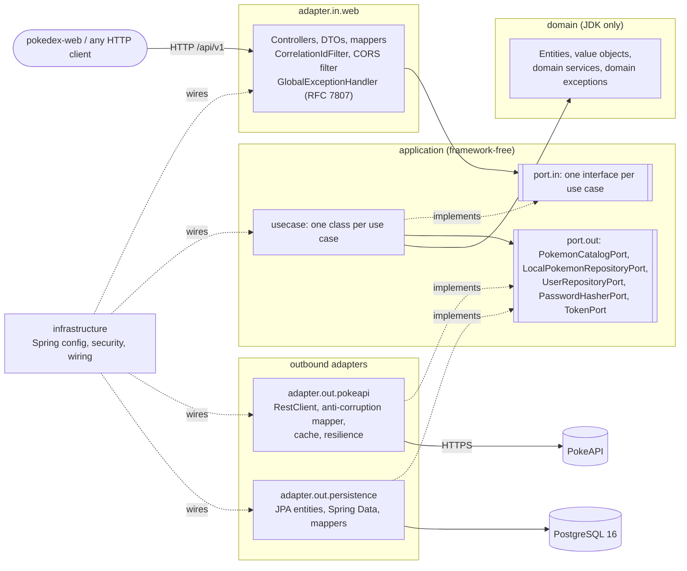

# Pokédex API

[](https://github.com/aleferod/pokedex-api/actions/workflows/ci.yml)


[](LICENSE)

A REST API built with Java 21 and Spring Boot for the Ballast Lane Java technical exercise. It browses Pokémon from [PokeAPI](https://pokeapi.co/docs/v2), keeps a local PostgreSQL replica with proprietary fields, and lets authenticated users manage that replica. It follows **Clean / Hexagonal Architecture** and is built **test-first** and **spec-first** with [OpenSpec](https://github.com/Fission-AI/OpenSpec). The frontend lives in [pokedex-web](https://github.com/aleferod/pokedex-web).

> **Status:** platform foundation done (`bootstrap-project`): error contract, correlation ids, CORS, health/info/OpenAPI, migrations, quality gates, Docker and CI. The user stories land one OpenSpec change at a time. See [Roadmap](#roadmap).

## Contents

- [Quick start](#quick-start)
- [User stories and endpoints](#user-stories-and-endpoints)
- [Error format](#error-format)
- [Architecture](#architecture)
- [Design patterns](#design-patterns)
- [Tech stack](#tech-stack)
- [Configuration](#configuration)
- [Testing and quality gates](#testing-and-quality-gates)
- [Spec-driven workflow (OpenSpec)](#spec-driven-workflow-openspec)
- [Architecture decisions](#architecture-decisions)
- [Roadmap](#roadmap)
- [Trade-offs and future improvements](#trade-offs-and-future-improvements)

## Quick start

You only need **Docker** (with Compose v2).

```bash
cp .env.example .env
docker compose up --build
```

| What | URL |
|---|---|
| API | http://localhost:8080 |
| Swagger UI | http://localhost:8080/swagger-ui.html |
| OpenAPI document | http://localhost:8080/v3/api-docs |
| Health | http://localhost:8080/actuator/health |

- **Ports:** PostgreSQL is published on host port **5433** (`DB_PORT`), so it won't clash with a PostgreSQL you may already run on 5432. If port 8080 is taken, change `SERVER_PORT` in `.env`.
- **Stop:** `docker compose down` keeps the data (named volume `pokedex-db-data`). `docker compose down -v` wipes it.
- **Run the API on the host instead (optional):** start only the database with `docker compose up -d postgres`, then run `./mvnw spring-boot:run`. This needs JDK 21. The default `local` profile reads the same `.env` and connects to `localhost:5433`.

The full stack with the web app (`docker-compose.full.yml`) and the seeded demo users arrive with the later changes listed in the [Roadmap](#roadmap).

## User stories and endpoints

| Story | Endpoint | Auth | Status |
|---|---|---|---|
| Operations | `GET /actuator/health`, `/actuator/health/liveness`, `/actuator/health/readiness` | public | ✅ |
| Operations | `GET /actuator/info` (name, version) | public | ✅ |
| API docs | `GET /v3/api-docs`, `GET /swagger-ui.html` | public | ✅ |
| Auth | `POST /api/v1/auth/register`, `POST /api/v1/auth/login`, `GET /api/v1/auth/me` | public / bearer | planned |
| US01 Enumeration | `GET /api/v1/pokemon?page=0&size=20` | public | planned |
| US02 Detail | `GET /api/v1/pokemon/{idOrName}` | public | planned |
| US03 Sync | `POST /api/v1/local-pokemon/sync/{idOrName}` | bearer | planned |
| US04 Local CRUD | `GET/POST /api/v1/local-pokemon`, `GET/PUT/PATCH/DELETE /api/v1/local-pokemon/{id}` | bearer (DELETE: `ADMIN`) | planned |

All other management endpoints (`/actuator/env`, `/beans`, `/heapdump`, `/shutdown`, …) are not exposed and return 404.

## Error format

Every error is an RFC 7807 problem detail (`application/problem+json`) with exactly these members: `type`, `title`, `status`, `detail`, `instance`, `timestamp` and `errors`. That holds for errors from controllers, from Spring MVC, from servlet filters (such as CORS) and from the servlet container.

```json
{
  "type": "https://github.com/aleferod/pokedex-api/blob/main/docs/problems.md#not-found",
  "title": "Resource not found",
  "status": 404,
  "detail": "No endpoint GET /api/v1/nope.",
  "instance": "/api/v1/nope",
  "timestamp": "2026-10-14T14:43:25.712Z",
  "errors": []
}
```

- **Problem types:** each `type` links to its section in [docs/problems.md](docs/problems.md).
- **No internals:** stack traces, exception names and SQL are never returned.
- **Unexpected failures:** these return a generic 500 that quotes the request's **correlation id**.
- **Correlation id:** every response carries an `X-Correlation-Id` header. A caller-supplied id is echoed if it is 1–64 characters of letters, digits and hyphens; otherwise a UUID is generated. Every log line for the request includes it.

## Architecture

Ports & Adapters. Dependencies point inward: **adapter → application → domain**. `infrastructure` wires everything together, and nothing depends on it.



| Package (`com.ballastlane.pokedex…`) | May depend on | Responsibility |
|---|---|---|
| `domain` | JDK only | Business model and rules |
| `application.port.in` / `.port.out` / `.usecase` | `domain`, JDK | Use cases and the ports they expose and need |
| `adapter.in.web` | application, domain, Spring | REST, DTOs, error translation, correlation id, CORS |
| `adapter.out.pokeapi` | application, domain, Spring | PokeAPI client and anti-corruption layer |
| `adapter.out.persistence` | application, domain, Spring/JPA | PostgreSQL persistence |
| `infrastructure` | everything | Configuration and wiring |

**Enforced, not just documented:** [`ArchitectureTest`](src/test/java/com/ballastlane/pokedex/architecture/ArchitectureTest.java) fails the build on any violation, and [`ArchitectureRulesSelfTest`](src/test/java/com/ballastlane/pokedex/architecture/ArchitectureRulesSelfTest.java) proves each rule catches a deliberately broken fixture. The rules also ban field injection, `System.out` and `java.util.logging`. The single-module-plus-ArchUnit trade-off is explained in [ADR-0001](docs/adr/0001-clean-hexagonal-architecture.md).

## Design patterns

| Pattern | Where | Status |
|---|---|---|
| Ports & Adapters | package layout, `application.port.in/out` | ✅ |
| Template Method | `GlobalExceptionHandler` overrides `ResponseEntityExceptionHandler#createResponseEntity` | ✅ |
| Factory | `ProblemDetailFactory`: the single place that builds problem details | ✅ |
| Chain of Responsibility | servlet filter chain: `CorrelationIdFilter` → `ProblemDetailCorsFilter` → DispatcherServlet | ✅ |
| Specification | `ArchitectureRules`: named, reusable architecture rules | ✅ |
| Value Object | `CorsProperties` (validates its invariants); `PokemonId`, `Weight` planned | ✅ / planned |
| Repository | persistence ports + Spring Data adapters | planned |
| Adapter / Anti-Corruption Layer | PokeAPI DTOs → domain mapper | planned |
| Strategy | evolution-chain flattening | planned |
| Decorator / Proxy | Spring Cache around the catalog port | planned |
| DTO + Mapper | web and persistence mappers (MapStruct) | planned |

## Tech stack

| Choice | Why |
|---|---|
| Java 21, Spring Boot 4.1 | Current supported Boot line; 3.5 is out of OSS support ([ADR-0006](docs/adr/0006-spring-boot-4.md)) |
| Spring Web MVC + `ProblemDetail` | Standard RFC 7807 errors |
| PostgreSQL 16 + Flyway | The schema is owned by versioned migrations; Hibernate runs `ddl-auto=validate` only |
| springdoc-openapi | OpenAPI 3 document and Swagger UI generated from the code |
| Actuator | Health, liveness/readiness probes and build info; nothing else is exposed |
| JUnit 6, AssertJ, Mockito, ArchUnit, Testcontainers | Fast unit tests, real-database integration tests, architecture tests ([ADR-0004](docs/adr/0004-testcontainers-over-in-memory-databases.md)) |
| Spotless (google-java-format), JaCoCo, Maven Enforcer | Formatting, coverage and dependency gates in every build |
| Docker (multi-stage, layered, non-root) + Compose | One-command local stack; the host needs only Docker |

Coming with later changes: Spring Security with JWT, Resilience4j, Caffeine, MapStruct and WireMock.

## Configuration

Everything that varies between environments comes from environment variables. `docker compose` and the `local` profile both read them from `.env`. Use [.env.example](.env.example) as the template; never commit `.env`.

| Variable | Default | Used for |
|---|---|---|
| `DB_NAME` / `DB_USERNAME` | `pokedex` | Database name and user |
| `DB_PASSWORD` | **none (required)** | Database password. Startup fails naming it if it's missing. |
| `DB_PORT` | `5433` | Host port where Postgres is published (local profile) |
| `DB_URL` | derived | Optional JDBC URL override for the local profile |
| `SERVER_PORT` | `8080` | Host port of the API |
| `APP_CORS_ALLOWED_ORIGINS` | `http://localhost:5173` | Comma-separated exact origins allowed to call `/api/**`. Wildcards are rejected at startup. |

| Profile | When |
|---|---|
| `local` (default) | Running on the host; imports `.env` |
| `docker` | Inside the Compose stack; the database is the `postgres` service, port 8080 |
| `test` | Automated tests; the database comes from Testcontainers |

## Testing and quality gates

```bash
# Everything, inside Docker (host needs only Docker): compile, all tests, every gate
./scripts/verify-in-docker.sh

# Same on the host (JDK 21 + Docker for Testcontainers)
./mvnw verify

# One test class / reformat code / coverage table
./scripts/verify-in-docker.sh -Dtest=CorrelationIdFilterTest -Dsurefire.failIfNoSpecifiedTests=false -DskipITs
./mvnw spotless:apply
./scripts/coverage-summary.sh        # after a verify; HTML report: target/site/jacoco/index.html
```

`verify-in-docker.sh` mounts the Docker socket and uses `--network host`, so Testcontainers can start PostgreSQL next to the build. On **Docker Desktop** (macOS or Windows), run `./mvnw verify` on the host instead.

| Layer | Tooling | Examples |
|---|---|---|
| Unit | JUnit 6, AssertJ, Mockito | `CorrelationIdFilterTest`, `CorsPropertiesTest` |
| Web slice | `@WebMvcTest` via [`@WebSliceTest`](src/test/java/com/ballastlane/pokedex/support/WebSliceTest.java) | `GlobalExceptionHandlerTest`, `CrossOriginTest` |
| Integration (`*IT`, Failsafe) | `@SpringBootTest` + Testcontainers PostgreSQL 16 via [`@IntegrationTest`](src/test/java/com/ballastlane/pokedex/support/IntegrationTest.java) | `OperationalEndpointsIT`, `SchemaMigrationIT`, `HealthDatabaseDownIT` |
| Architecture | ArchUnit | `ArchitectureTest`, `ArchitectureRulesSelfTest` |

Test names follow `should_<expected>_when_<condition>`, with Given / When / Then bodies. Tests are written first: each change's pull request shows a failing `test:` commit before the `feat:` commit that makes it pass.

**Build gates.** Any of these fails `verify`, locally and in CI:
- compiler warnings (`-Xlint:all -Werror`)
- formatting (Spotless)
- architecture rules (ArchUnit)
- line coverage of `domain` + `application` below 85% (JaCoCo)
- banned dependencies: H2/HSQLDB/Derby and JUnit 4 (Maven Enforcer)

**CI** ([`.github/workflows/ci.yml`](.github/workflows/ci.yml)) runs on every push to `main` and every pull request:
- build and all tests, with a coverage summary and the HTML report as an artifact
- `openspec validate --all --strict`
- a Docker image build
- a gitleaks secret scan over the full history

## Spec-driven workflow (OpenSpec)

Every capability is specified before it's built ([ADR-0005](docs/adr/0005-spec-driven-development-with-openspec.md)):
- **Project context and rules:** [`openspec/config.yaml`](openspec/config.yaml), covering the stack, architecture rules, conventions and Definition of Done.
- **In-flight changes:** [`openspec/changes/`](openspec/changes). Each has a proposal, a design, tasks (tests first) and delta specs with `SHALL` requirements and `WHEN/THEN` scenarios.
- **Source of truth after archiving:** [`openspec/specs/`](openspec/specs).

The process for each change:
1. Propose.
2. `openspec validate <change> --strict`.
3. Implement test-first.
4. Archive (as the last commit of the PR).
5. Squash-merge once CI is green.

## Architecture decisions

See [docs/adr](docs/adr/README.md). Written so far:
- 0001: Clean/Hexagonal Architecture in one module, enforced by ArchUnit
- 0004: Testcontainers instead of H2
- 0005: OpenSpec
- 0006: Spring Boot 4.1

## Roadmap

Each item is one OpenSpec change and one pull request:

1. ✅ `bootstrap-project`: platform foundation
2. `add-user-auth`: register/login (JWT), users table, public vs protected routes, roles
3. `add-pokemon-catalog`: US01 paginated catalog with parallel detail fetching
4. `add-pokemon-detail`: US02 stats, description, evolution chain
5. `add-local-sync`: US03 import into PostgreSQL with proprietary fields
6. `add-local-crud`: US04 CRUD with validation, ETags and optimistic locking
7. `add-caching-resilience`: Caffeine cache, timeouts, retry and circuit breaker
8. `add-seed-data`: demo users and about 10 local Pokémon
9. `add-genai-task-api-doc`: the GenAI exercise write-up (`docs/GENAI.md`)

## Trade-offs and future improvements

- **One module plus ArchUnit, not multi-module Maven.** Easier to read and review. The layering is enforced when tests run, not when code compiles. See ADR-0001.
- **Empty `V1__baseline.sql`.** Tables arrive with the feature that needs them, so the history reads one capability per change.
- **Squash merges.** `main` stays linear. The red/green TDD commits remain visible in each pull request.
- **Future work:**
  - structured JSON logs and distributed tracing (Micrometer/OpenTelemetry)
  - a Redis cache for multi-instance deployments
  - image publishing and a deploy pipeline
  - contract tests shared with the frontend

## License

[MIT](LICENSE)
