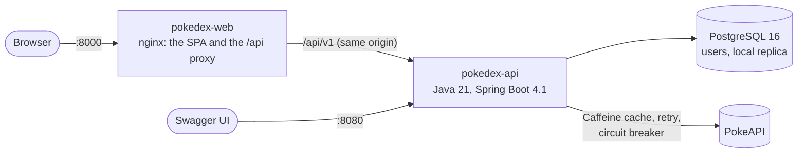

# Presentation and code review guide

A guide for presenting the Pokédex (this API and [pokedex-web](https://github.com/aleferod/pokedex-web)) in about 30 minutes, then reviewing the code. Every number says how to reproduce it, and every claim links to the code or document behind it. It was written on 2026-10-15 as the API's 10th change, and updated on 2026-10-16 for the catalog search, with pokedex-api's 11 changes and pokedex-web's 8 merged.

## Contents

- [The 30 minutes](#the-30-minutes)
- [Before the session](#before-the-session)
- [The demo](#the-demo)
- [Architecture](#architecture)
- [Decisions worth discussing](#decisions-worth-discussing)
- [Quality evidence](#quality-evidence)
- [Code-review entry points](#code-review-entry-points)
- [How it was built](#how-it-was-built)
- [Likely questions](#likely-questions)

## The 30 minutes

| Time | Block | Goal |
|---|---|---|
| 0–3 | **Scope** | The brief's four user stories, the two repositories, and the one-command full stack |
| 3–13 | **[The demo](#the-demo)** | US01–US04 live, as a visitor, as `trainer` and as `admin`, including a real 409 |
| 13–20 | **[Architecture](#architecture) and [decisions](#decisions-worth-discussing)** | Hexagonal backend enforced by ArchUnit; the frontend's server state, URL state and optimistic concurrency |
| 20–25 | **[Quality](#quality-evidence) and [process](#how-it-was-built)** | TDD in the pull requests, the gates, end-to-end and accessibility tests, OpenSpec, and AI with guardrails |
| 25–30 | **Trade-offs and questions** | What I'd do next ([README](../README.md#trade-offs-and-future-improvements)), then [likely questions](#likely-questions) |

Then the code review, starting from the [entry points](#code-review-entry-points).

## Before the session

1. Start the full stack about ten minutes early, from a clone of pokedex-web:
   ```bash
   git clone https://github.com/aleferod/pokedex-web.git && cd pokedex-web
   cp .env.example .env && docker compose -f docker-compose.full.yml up --build --wait
   ```
   The app is at <http://localhost:8000> and Swagger UI at <http://localhost:8080/swagger-ui.html>.
2. Warm the API's cache by walking demo steps 1 and 2 once. That loads the pages, the index of all names and the Pokémon the demo opens. For the next hour they come from the Caffeine cache, so the demo doesn't wait on PokeAPI.
3. Open two browser windows for step 5 (the session lives in `sessionStorage`, one per tab).
4. Keep the fallbacks at hand:
   - the [screenshots](https://github.com/aleferod/pokedex-web#screenshots)
   - [pokedex-web's CI runs](https://github.com/aleferod/pokedex-web/actions/workflows/ci.yml), whose "End-to-end" job drives the same journeys against a fresh stack

## The demo

The demo accounts come from the demo data: `trainer / Trainer@123` (USER) and `admin / Admin@123` (ADMIN).

1. **Catalog (US01), as a visitor.** Open **Catalog** and set **Per page** to 40, which starts again from page 1. Go to the next page, then copy the URL (`/pokemon?page=2&size=40`) into a new tab.
   - **Say:** the URL is the state, so views can be shared.
   - **Say:** the API builds each page from PokeAPI with a bounded fan-out on virtual threads ([`BoundedFanOut`](../src/main/java/com/ballastlane/pokedex/adapter/out/pokeapi/BoundedFanOut.java)) behind a cache Decorator ([`CachingPokemonCatalog`](../src/main/java/com/ballastlane/pokedex/adapter/out/cache/CachingPokemonCatalog.java)).
   - **Say:** the frontend shows the current page while it fetches the next.
   - **Search:** type `pi` in **Find a Pokémon**. Nothing happens yet: the hint asks for 3 letters. Add `ka`. After a short pause the grid shows the 17 Pokémon whose name contains `pika`, Pikachu first, and the URL becomes `/pokemon?size=40&name=pika`. Focus stays in the field.
   - **Say:** PokeAPI can't search, so the API filters a cached index of all names and fetches only the matching page's entries ([`ListPokemonUseCase`](../src/main/java/com/ballastlane/pokedex/application/usecase/pokemon/ListPokemonUseCase.java)). The browser waits for a pause in the typing and replaces the history entry, so Back doesn't step through each letter.
2. **Detail (US02).** Search `eevee` and open Eevee's card (#133). A number works too: `133` and Enter opens Eevee.
   - Show the stats table and the evolution tree with its 8 branches and their conditions. Follow **Sylveon**: focus moves to its name.
   - **Back to the catalog** returns to where you came from: the search, or the catalog page if you came from a page.
   - **Say:** each condition is built by a Strategy chosen per PokeAPI trigger ([`EvolutionConditions`](../src/main/java/com/ballastlane/pokedex/adapter/out/pokeapi/evolution/EvolutionConditions.java)), and the chain stays a tree.
3. **The local replica (US03), as `trainer`.** Open **My Pokédex**: you're sent to sign in and come back.
   - Filter by the tag `starter`, then follow a tag chip.
   - In **Sync from PokeAPI**, enter `eevee` (it's imported, 201). Then enter `25`: Pikachu is re-synced (200), with **its proprietary fields kept**.
   - **Say:** a re-sync replaces only the upstream half of the aggregate ([`LocalPokemon`](../src/main/java/com/ballastlane/pokedex/domain/localpokemon/LocalPokemon.java)), and a concurrent first import is tested against a real race ([`LocalPokemonSyncIT`](../src/test/java/com/ballastlane/pokedex/adapter/in/web/localpokemon/LocalPokemonSyncIT.java)).
4. **Editing (US04).** On Eevee's record, add the tag `Eeveelution`: it shows at once and is normalised to `eeveelution` (an optimistic merge patch with `If-Match`).
   - Open **Edit**, enter `Bad Tag!` as a tag and a 51-character region, then choose **Save changes**. Every broken rule is listed at once, in the API's own words, and nothing is sent.
   - **Say:** the forms mirror the domain's rules ([`ProprietaryData`](../src/main/java/com/ballastlane/pokedex/domain/localpokemon/ProprietaryData.java)), and the API's 400s still land on the fields.
5. **No lost updates, then roles.**
   - **A real 409:** in window A, open **Edit** on Eevee. In window B (signed in as `trainer` too), edit Eevee's notes and save. Back in window A, change the region and save. You get a 409: "Someone else changed this record after you opened it…". Your input is kept, and **Load the latest version** brings in B's notes.
   - **Roles:** sign in as `admin`. **Delete** asks for confirmation (focus on **Cancel**) and returns to the list with a message. `trainer` never sees the button, and the API answers 403 anyway.
   - **Say:** the ETag is the aggregate's version, the edit form keeps the version it loaded, and the use case and JPA's `@Version` both check it ([`IfMatch`](../src/main/java/com/ballastlane/pokedex/adapter/in/web/localpokemon/IfMatch.java)).

**If the network or PokeAPI misbehaves:**
- The cache warmed before the session covers steps 1–2, and the local replica (steps 3–5) reads PostgreSQL.
- Syncing a Pokémon that isn't cached needs PokeAPI. If it's down, the API answers 503 with `Retry-After`, and the app says "PokeAPI is temporarily unavailable". That's worth showing on purpose.
- Otherwise, use the screenshots and the recorded CI end-to-end run.

## Architecture



- **Backend:** Ports & Adapters, with dependencies pointing inward (adapter → application → domain); `infrastructure` wires them. The layers, ports and adapters are in the [README's architecture section](../README.md#architecture), with a diagram.
  - **Enforced, not documented:** [`ArchitectureTest`](../src/test/java/com/ballastlane/pokedex/architecture/ArchitectureTest.java) fails the build on a layering violation, and [`ArchitectureRulesSelfTest`](../src/test/java/com/ballastlane/pokedex/architecture/ArchitectureRulesSelfTest.java) proves each rule catches a broken fixture.
  - **Patterns:** about twenty, from Decorator and Circuit Breaker to Optimistic Offline Lock and Merge Patch, listed in the [README's design patterns table](../README.md#design-patterns).
- **Frontend:** React 19 + TypeScript (strict), with one folder per feature: `auth`, `catalog`, `detail` and `local`.
  - **Server state:** TanStack Query.
  - **Shareable state:** the URL holds the page, size and filters.
  - **Errors:** one `ApiError` built from the API's RFC 7807 problems.
  - **Same origin:** the browser talks only to its own origin, with nginx in production and Vite in development proxying `/api`.
  - **More:** the [pokedex-web README](https://github.com/aleferod/pokedex-web#project-structure).

## Decisions worth discussing

| Decision | Why | Where |
|---|---|---|
| One Maven module with ArchUnit rules, not multi-module | easier to read and review, and the layering still fails the build | [ADR-0001](adr/0001-clean-hexagonal-architecture.md) |
| Stateless JWT (HS256), held in the browser's `sessionStorage` | no server session, no cookies, no CSRF; the token lives in one tab, at most 1 h; HttpOnly cookies would need backend work | [ADR-0002](adr/0002-stateless-jwt-authentication.md), [auth UI design D1](https://github.com/aleferod/pokedex-web/blob/main/openspec/changes/archive/2026-10-15-add-auth-ui/design.md) |
| A Caffeine cache Decorator, plus Resilience4j retry and a circuit breaker on every PokeAPI call | the use cases can't tell; failures are fast; 404s never trip the breaker | [ADR-0003](adr/0003-caffeine-cache-and-resilience4j-for-pokeapi.md) |
| Testcontainers PostgreSQL, never H2 (banned by the Maven Enforcer) | arrays, GIN indexes and `@Version` behave as in production | [ADR-0004](adr/0004-testcontainers-over-in-memory-databases.md) |
| Spec-first with OpenSpec | each change is proposed, designed, specified and archived in its own PR | [ADR-0005](adr/0005-spec-driven-development-with-openspec.md) |
| Spring Boot 4.1 over 3.5 | 3.5's open-source support had ended | [ADR-0006](adr/0006-spring-boot-4.md) |
| 409, not 412, for a stale `If-Match`; 428 without one | the brief asks for 409 | [README trade-offs](../README.md#trade-offs-and-future-improvements) |
| JSON Merge Patch with a tri-state field (keep, clear, set) | an absent member keeps its value and `null` clears it; read-only members are rejected by name | [`MergePatchReader`](../src/main/java/com/ballastlane/pokedex/adapter/in/web/localpokemon/MergePatchReader.java) |
| `If-Match` from the version the user saw; the edit form keeps its loaded version | a background refetch must not turn a stale edit into an overwrite | [local UI design D3 and D9](https://github.com/aleferod/pokedex-web/blob/main/openspec/changes/archive/2026-10-15-add-local-pokemon-management-ui/design.md) |
| Search by part of a name, over a cached index of all names; at least 3 characters; the browser searches after a 300 ms pause | PokeAPI has no search; the index is one cached request, and only the matching page is fetched in detail; containment in Pokédex order puts the main form first; the URL is replaced while typing, so Back skips each letter | [API search design D2–D4](../openspec/changes/archive/2026-10-15-add-catalog-name-search/design.md), [search UI design D2](https://github.com/aleferod/pokedex-web/blob/main/openspec/changes/archive/2026-10-16-add-catalog-search-ui/design.md) |
| Tags edited optimistically, rolled back on refusal | instant feedback, with one change in flight at a time | the same design, D8 |
| The end-to-end suite uses the real PokeAPI | it also exercises the cache, retries and breaker; an outage is an honest failure | [e2e design D5](https://github.com/aleferod/pokedex-web/blob/main/openspec/changes/archive/2026-10-15-add-e2e-and-polish/design.md) |

## Quality evidence

| What | Result | Reproduce |
|---|---|---|
| API unit and slice tests | **556** | `./scripts/verify-in-docker.sh` (needs only Docker) |
| API integration tests (Testcontainers PostgreSQL, WireMock with real PokeAPI captures) | **68** | the same command |
| API line coverage, domain + application | **100 %** (the gate is 85 %); the whole code base 98.0 % | `./scripts/coverage-summary.sh` after a verify |
| API build gates | `-Xlint:all -Werror`, Spotless, ArchUnit, JaCoCo, Maven Enforcer | part of `verify` |
| Web unit tests (Vitest, React Testing Library, MSW) | **231**; coverage 98.4 % statements, 90.4 % branches, 98.9 % functions, 98.3 % lines (gate 85/80) | `./scripts/npm-in-docker.sh run test:coverage` in pokedex-web |
| Web gates | ESLint with zero warnings (type-aware), Prettier, strict TypeScript; **any `console.error`/`warn` fails a test**; an unmocked request fails a test | the same, and CI |
| End-to-end, real stack | **12 tests**, including axe (WCAG 2.1 A/AA) on every main page with no violations | `./scripts/e2e.sh` in pokedex-web |
| Specs | **18 capabilities** here (with this guide's) **+ 8** in pokedex-web, all valid | `openspec validate --all --strict` in each repository |
| Secrets | gitleaks over the full history of both repositories | CI |

**The TDD trail:** each pull request shows a failing `test:` commit before the `feat:` commit that makes it pass. Pull requests: [pokedex-api](https://github.com/aleferod/pokedex-api/pulls?q=is%3Apr+is%3Amerged) and [pokedex-web](https://github.com/aleferod/pokedex-web/pulls?q=is%3Apr+is%3Amerged).

## Code-review entry points

**pokedex-api:**

| File | Look at |
|---|---|
| [`ArchitectureTest`](../src/test/java/com/ballastlane/pokedex/architecture/ArchitectureTest.java) | the layering rules that fail the build |
| [`GlobalExceptionHandler`](../src/main/java/com/ballastlane/pokedex/adapter/in/web/error/GlobalExceptionHandler.java) and [`ProblemDetailFactory`](../src/main/java/com/ballastlane/pokedex/adapter/in/web/error/ProblemDetailFactory.java) | one RFC 7807 contract for every error, with no stack traces |
| [`CorrelationIdFilter`](../src/main/java/com/ballastlane/pokedex/adapter/in/web/correlation/CorrelationIdFilter.java) | the correlation id on every response and log line |
| [`LocalPokemon`](../src/main/java/com/ballastlane/pokedex/domain/localpokemon/LocalPokemon.java) | the aggregate: upstream data vs proprietary data, import and re-sync |
| [`ProprietaryData`](../src/main/java/com/ballastlane/pokedex/domain/localpokemon/ProprietaryData.java) | the Notification pattern: every broken rule in one 400 |
| [`MergePatchReader`](../src/main/java/com/ballastlane/pokedex/adapter/in/web/localpokemon/MergePatchReader.java) and [`IfMatch`](../src/main/java/com/ballastlane/pokedex/adapter/in/web/localpokemon/IfMatch.java) | merge patch, read-only members, and the version check |
| [`PokemonNameQuery`](../src/main/java/com/ballastlane/pokedex/domain/pokemon/PokemonNameQuery.java) and [`ListPokemonUseCase`](../src/main/java/com/ballastlane/pokedex/application/usecase/pokemon/ListPokemonUseCase.java) | the search's rule as a value object, and a page of matches that fetches only that page's entries |
| [`SyncPokemonUseCase`](../src/main/java/com/ballastlane/pokedex/application/usecase/localpokemon/SyncPokemonUseCase.java) | a use case with no framework, behind its ports |
| [`CachingPokemonCatalog`](../src/main/java/com/ballastlane/pokedex/adapter/out/cache/CachingPokemonCatalog.java) and [`PokeApiResilience`](../src/main/java/com/ballastlane/pokedex/adapter/out/pokeapi/PokeApiResilience.java) | the Decorator, retries with jitter, and the circuit breaker |
| [`JwtTokenIssuer`](../src/main/java/com/ballastlane/pokedex/adapter/out/security/JwtTokenIssuer.java) and [`PasswordPolicy`](../src/main/java/com/ballastlane/pokedex/domain/user/password/PasswordPolicy.java) | tokens and the password rule chain |
| [`LocalPokemonSyncIT`](../src/test/java/com/ballastlane/pokedex/adapter/in/web/localpokemon/LocalPokemonSyncIT.java) | integration tests against PostgreSQL, including a real concurrent-import race |

**pokedex-web:**

| File | Look at |
|---|---|
| [`client.ts`](https://github.com/aleferod/pokedex-web/blob/main/src/shared/api/client.ts) and [`ApiError.ts`](https://github.com/aleferod/pokedex-web/blob/main/src/shared/api/ApiError.ts) | one client and one error type, built from the API's problems |
| [`AuthProvider.tsx`](https://github.com/aleferod/pokedex-web/blob/main/src/features/auth/AuthProvider.tsx) and [`AuthNav.tsx`](https://github.com/aleferod/pokedex-web/blob/main/src/features/auth/AuthNav.tsx) | `useLayoutEffect` so the first query carries the token; `flushSync` so signing out never bounces to sign-in |
| [`FindPokemonForm.tsx`](https://github.com/aleferod/pokedex-web/blob/main/src/features/catalog/FindPokemonForm.tsx) | search as you type: the pause, the URL replaced, and a field that follows the URL only when it changes from outside (Back, "Clear search") |
| [`SubmitButton.tsx`](https://github.com/aleferod/pokedex-web/blob/main/src/shared/ui/form/SubmitButton.tsx) | why pressing a submit button keeps focus in the field: otherwise the field's errors move the button and the click is lost |
| [`useLocal.ts`](https://github.com/aleferod/pokedex-web/blob/main/src/features/local/useLocal.ts) | queries, mutations, and the optimistic tag change with rollback |
| [`LocalEditPage.tsx`](https://github.com/aleferod/pokedex-web/blob/main/src/features/local/LocalEditPage.tsx) | the edit form that keeps its loaded version, and the 409 flow |
| [`rules.ts`](https://github.com/aleferod/pokedex-web/blob/main/src/features/local/rules.ts) | the API's rules mirrored with its messages (Zod 4) |
| [`setup.ts`](https://github.com/aleferod/pokedex-web/blob/main/src/test/setup.ts) and [`localApi.ts`](https://github.com/aleferod/pokedex-web/blob/main/src/test/localApi.ts) | the console guard, and an in-memory fake API that checks `If-Match` |
| [`local.e2e.ts`](https://github.com/aleferod/pokedex-web/blob/main/e2e/local.e2e.ts) and [`e2e.sh`](https://github.com/aleferod/pokedex-web/blob/main/scripts/e2e.sh) | a real 409 from a second client, against a throwaway full stack |
| [`docker-compose.full.yml`](https://github.com/aleferod/pokedex-web/blob/main/docker-compose.full.yml) | the whole product, healthy before `up --wait` returns |

## How it was built

- **Spec-first:** each change (12 here, including this guide and its update, and 8 in pokedex-web) started as an OpenSpec proposal with a design, tasks and spec deltas, and was validated in CI. Its pull request ends with the archive commit. The archives are in `openspec/changes/archive/` in [this repository](../openspec/changes/archive) and in [pokedex-web](https://github.com/aleferod/pokedex-web/tree/main/openspec/changes/archive).
- **Test-first:**
  - red `test:` commits before green ones
  - tests that passed at red were inspected, which caught several vacuous ones
  - acceptance and end-to-end tests were mutation-checked
- **Machine checks over opinions:** the gates above, plus fresh-clone builds and real-browser checks against the real API. The browser checks found what jsdom couldn't, such as a sign-out race and a misleading `aria-current`.
- **AI with guardrails:** built with Claude Code, with me in charge of scope, decisions, CI and merges. [`GENAI.md`](GENAI.md#4-how-this-pokédex-was-built-with-ai) lists every real AI mistake and what caught it, and answers the exercise's GenAI part.

## Likely questions

- **Why hexagonal for an API this size?** The use cases are about the domain, not Spring. Swapping the cache, PokeAPI or the database touches only an adapter, and ArchUnit keeps it that way ([ADR-0001](adr/0001-clean-hexagonal-architecture.md)).
- **What if PokeAPI is down?**
  - Cached pages and details are still served for up to an hour.
  - Calls that aren't cached fail fast with 503 and `Retry-After` while the breaker is open.
  - The local replica doesn't depend on PokeAPI at all.
  - Next step: serve stale entries if PokeAPI errors ([README trade-offs](../README.md#trade-offs-and-future-improvements)).
- **Why not ask PokeAPI to search?** Its REST API looks Pokémon up by exact name or number only. The API reads PokeAPI's list of all names once, in one request of about 90 KB, caches it for an hour like a page, filters it, and fetches only the matching page's entries ([README](../README.md#catalog-us01)).
- **Two users edit the same record?** The second write carries an older version and gets 409. The UI explains, keeps the input, and offers the latest version. Try it in [step 5](#the-demo).
- **Why `sessionStorage` for the token?** Both web storages are readable by injected script, so the real defence is having no XSS sinks. One tab and at most one hour limit the exposure, and HttpOnly cookies would need CSRF handling and backend work ([ADR-0002](adr/0002-stateless-jwt-authentication.md)).
- **How do you know the tests test something?** Red first, inspecting anything that passed at red, and mutation checks. For example, removing the cache Decorator, the retries or the `flushSync` fix makes the tests fail.
- **What would you do next?** Structured logs and tracing, a Redis cache behind the same Decorator, refresh tokens, login rate limiting, contract tests shared by both repositories, and image publishing ([README](../README.md#trade-offs-and-future-improvements)).
